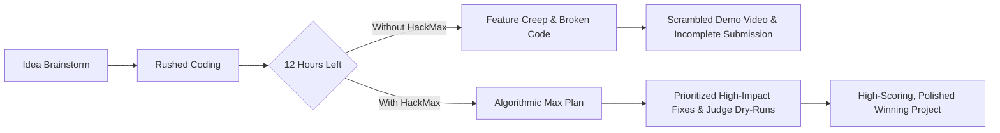
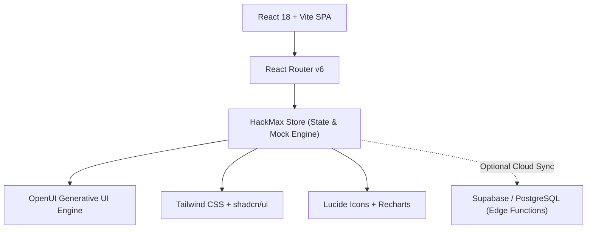

# HackMax ⚡

<div align="center">


### **Maximize your hackathon.**
*The AI-native command center and build copilot that optimizes submission quality per hour remaining.*

[](https://www.typescriptlang.org/)
[](https://react.dev/)
[](https://vitejs.dev/)
[](https://tailwindcss.com/)
[](https://openui.com)
[](https://bun.sh)
[](LICENSE)

</div>

---

> **"What should I do next, and why is it the highest-impact thing right now?"**  
> Most hackathon teams don't lose because they lack engineering ability—they lose because they misallocate the final 12 hours. **HackMax** is a dark-first, high-density mission control inspired by Linear, GitHub, and Notion. It connects live commit telemetry, AI judging simulations, and a real-time **Max Score** to turn panicked countdowns into structured, winning submissions.

---

## ⚡ The Hackathon Dilemma

Hackathons are high-stress sprints with strict deadlines, shifting priorities, and unforgiving submission portals:



HackMax fixes the chaotic final sprint by answering three critical questions at all times:
1. **Are we building what the judges actually score?**
2. **What low-impact features must be ruthlessly cut right now?**
3. **Is our demo video, public repo, and README ready to impress?**

---

## ✨ Key Capabilities

### 1. ⏱️ Real-Time Urgency Command Center
- **Dynamic Countdown Clocks**: Precision millisecond countdowns that elevate color urgency (`OK` → `WARN` → `HOT` → `CRITICAL`) as the deadline approaches.
- **Max Score Readiness Gauge (0–100)**: Transparent weighted score derived from core functionality, judging rubric alignment, UX polish, demo readiness, and time buffer.
- **Highest-Impact Action Card**: Pinpoints the single most leveraged task to work on next, explaining *why* it moves the needle and estimating the Max Score lift.

### 2. 📋 Time-Sliced Max Plan (`NOW` / `NEXT` / `LATER` / `SUBMISSION`)
- Categorizes work into structured sprint horizons:
  - **`NOW`**: Active, critical path items with direct judging impact.
  - **`NEXT`**: Secondary features queued immediately after.
  - **`LATER`**: Nice-to-have buffer items automatically marked for cutting when time gets tight.
  - **`SUBMISSION`**: Mandatory checklist gates (working demo URL, clean video walkthrough, public repo, architecture diagram).

### 3. 🤖 Max Copilot & OpenUI Generative Cards
- Global drawer accessible from any screen via `Cmd+K` or the top bar.
- Interactive AI build partner powered by `@openuidev/react-lang` that renders real-time generative UI cards for criteria audits, pitch drafting, and task breakdowns.
- Instant triage actions: *"What should I cut?"*, *"Review my pitch"*, *"Am I on track?"*.

### 4. ⚖️ Multi-Persona AI Judge Simulation
- Test your project against 4 simulated judge archetypes:
  - 🛠️ **Technical Lead**: Strict evaluation of architecture, code quality, stability, and tech stack depth.
  - 💼 **Product / Business Judge**: Market viability, problem-solution fit, and real-world utility.
  - 🎨 **UX & Design Critic**: User journey clarity, visual hierarchy, error states, and polish.
  - 🏆 **Overall Hackathon Judge**: Balancing innovation, execution completeness, and presentation.
- Yields immediate weakness breakdowns, scores per criterion, and one-click recommended fixes.

### 5. 🧬 Cross-Hackathon DNA & Reusability Matrix
- Indexes your past repositories and projects into reusable architectural components and capabilities (Auth flows, Vector DB connectors, Webhook receivers, LLM evaluation pipelines).
- Calculates reuse percentages when evaluating new hackathons to maximize development velocity.

### 6. 🐙 GitHub Telemetry & Velocity Engine
- Direct telemetry integration tracking commit cadence, open pull requests, and activity feeds.
- Correlates code velocity with readiness milestones to ensure the repo stays green before submission deadlines.

### 7. 🛡️ 100% Offline / Zero-Config Demo Mode
- Fully functional interactive client-side engine with realistic seed data (*Autonomous Agents Hackathon* + *Agentic Researcher*).
- Explore the entire application without needing external API keys or third-party accounts.

---

## 🗺️ Application Map & Routes

| Route | View | Description |
| :--- | :--- | :--- |
| `/` | **Landing Page** | Dark dev-tool landing page featuring live interactive previews and product tour. |
| `/dashboard` | **Command Center** | Central hub: Urgency countdown, Max Score gauge, highest-impact next action, and active projects. |
| `/hackathons` | **Hackathons Directory** | Overview of active and completed hackathons with countdowns and status tags. |
| `/hackathons/:id` | **Hackathon Workspace** | Execution cockpit: Criteria breakdown, Max Plan board, submission checklist, and details. |
| `/projects` | **Projects Catalog** | Repository management, tech stack tags, and Cross-Hackathon DNA capabilities. |
| `/projects/:id` | **Project Workspace** | Reusable components, commit velocity, and connected hackathon instances. |
| `/judge` | **Judge Simulation** | Multi-persona AI judge console with score rubrics, vulnerability audits, and suggested fixes. |
| `/opportunities` | **Opportunities** | Upcoming hackathon discovery matched against your project DNA with reuse percentages. |
| `/analytics` | **Analytics & Trajectory** | Readiness curves over time, hours spent vs impact, and anti-slop insights. |
| `/github` | **GitHub Telemetry** | Repository switcher, commit timelines, and development velocity stats. |
| `/settings` | **Settings** | Profile config, demo mode toggles, and notification preferences. |
| `/onboarding` | **5-Step Onboarding** | Welcome flow: goals, repo sync, hackathon URL extraction, and initial Max Plan generation. |

---

## 🛠️ Architecture & Tech Stack



- **Runtime & Tooling**: [Bun](https://bun.sh) (fast package management & scripts), [Vite 7](https://vitejs.dev/)
- **Frontend Core**: [React 18](https://react.dev/), [TypeScript 5.9](https://www.typescriptlang.org/) (Strict Mode)
- **Routing & State**: [React Router v6](https://reactrouter.com/), Custom React Store with TanStack Query patterns
- **Generative AI UI**: [@openuidev/react-lang](https://openui.com) for real-time dynamic AI components
- **Design System & Components**: [Tailwind CSS](https://tailwindcss.com/), [Radix UI](https://www.radix-ui.com/), [Lucide React](https://lucide.dev/), [Recharts](https://recharts.org/), [Sonner](https://sonner.emilkowal.ski/)
- **Backend & Auth** *(Optional)*: [Supabase](https://supabase.com/) PostgreSQL + Edge Functions

---

## 🚀 Getting Started

### Prerequisites
- [Bun](https://bun.sh) (recommended) or [Node.js](https://nodejs.org/) (v18+)
- [Git](https://git-scm.com/)

### 1. Clone the Repository
```bash
git clone https://github.com/Ash-Blanc/hackmax.git
cd hackmax
```

### 2. Install Dependencies
```bash
bun install
# or npm install / pnpm install
```

### 3. Start Local Development Server
```bash
bun dev
```
Open [http://localhost:5173](http://localhost:5173) in your browser. The application runs immediately in **Demo Mode** with rich pre-loaded data!

### 4. Build for Production
```bash
bun run build
```

### 5. Run Typechecks
```bash
bun run typecheck
```

---

## 🎨 Design System & Aesthetics

HackMax adopts an ultra-dense, keyboard-first, distraction-free aesthetic:
- **Backgrounds**: Deep obsidian (`#08090d`), card surfaces (`#0f111a`), elevated menus (`#181b26`)
- **Accents**: Electric Indigo / Violet (`#6366f1` / `#818cf8`) with Emerald Glow (`#10b981`) for readiness and success
- **Borders**: Hairline strokes (`#1e2333` / `rgba(255, 255, 255, 0.08)`)
- **Typography**: Display titles in **Fenix**, clean body copy in **Inter**, and telemetry/code counters in **JetBrains Mono**

---

## 📄 License

This project is licensed under the [MIT License](LICENSE).

---

<div align="center">
Built for hackers, builders, and sprint winners. ⚡
</div>
